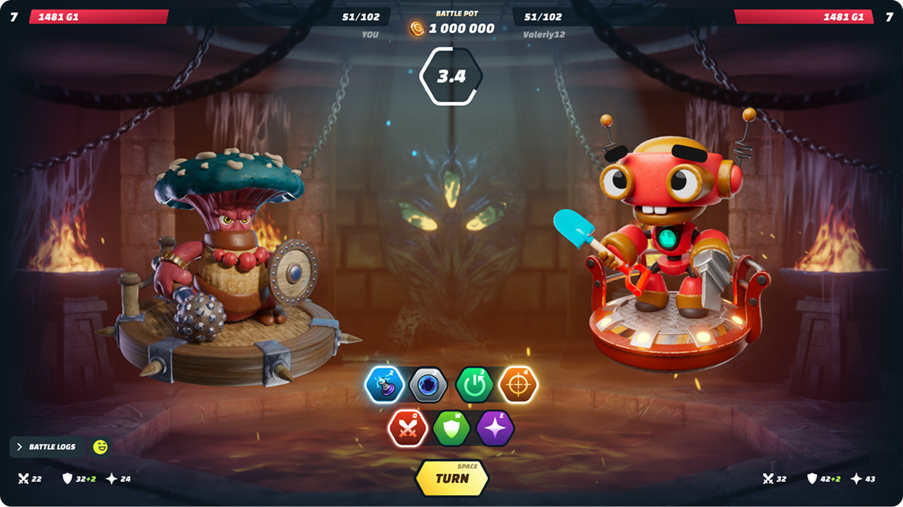
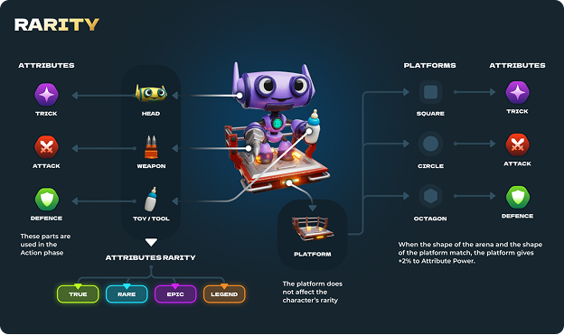
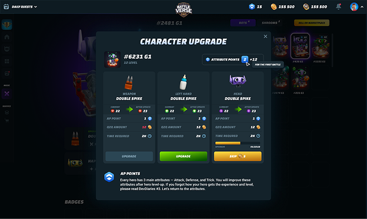
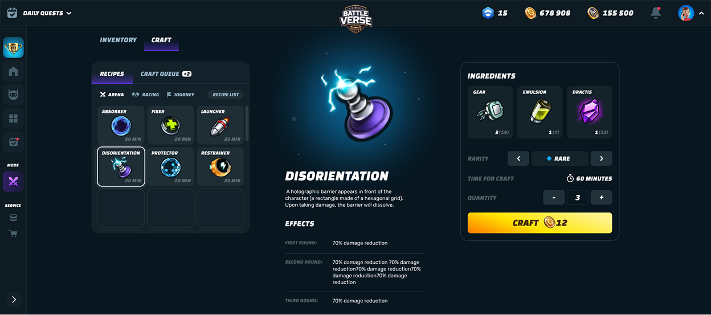
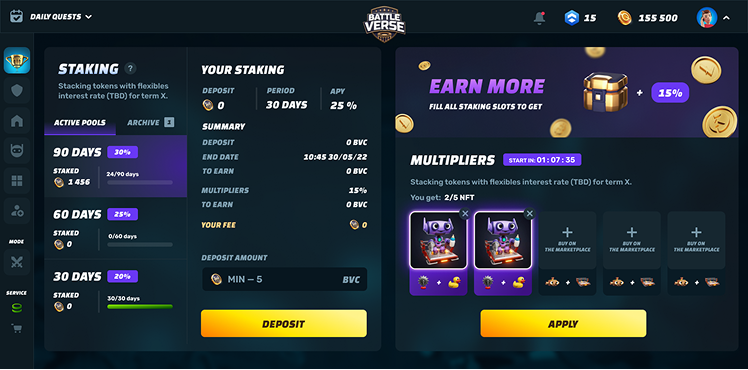
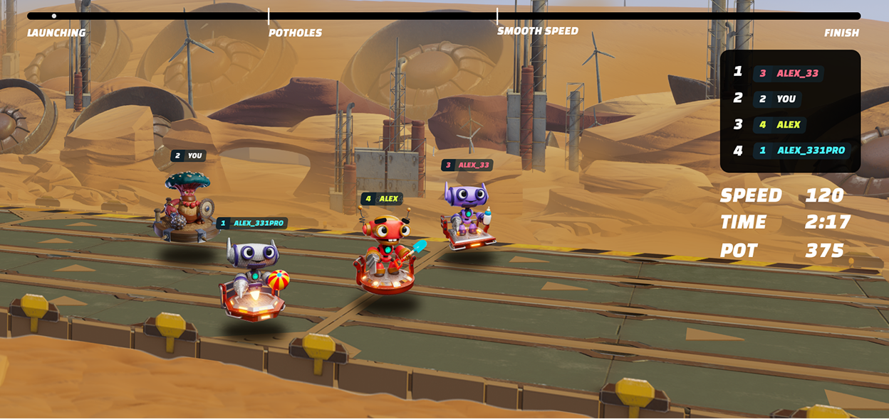
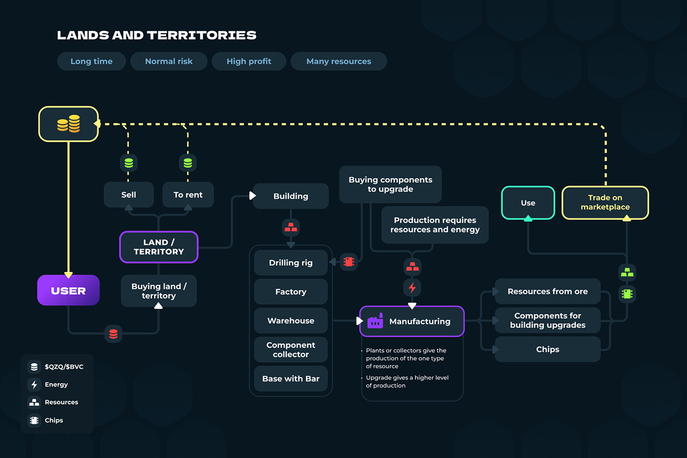
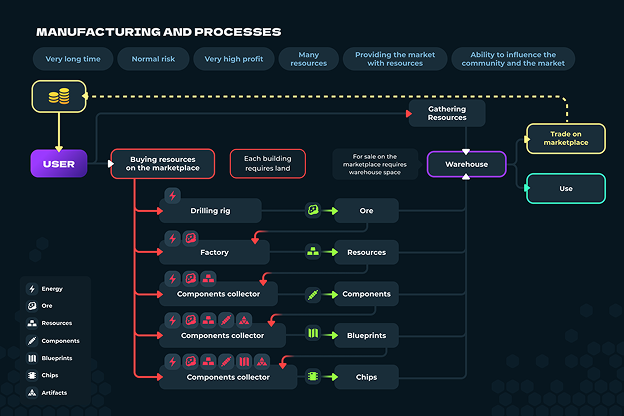
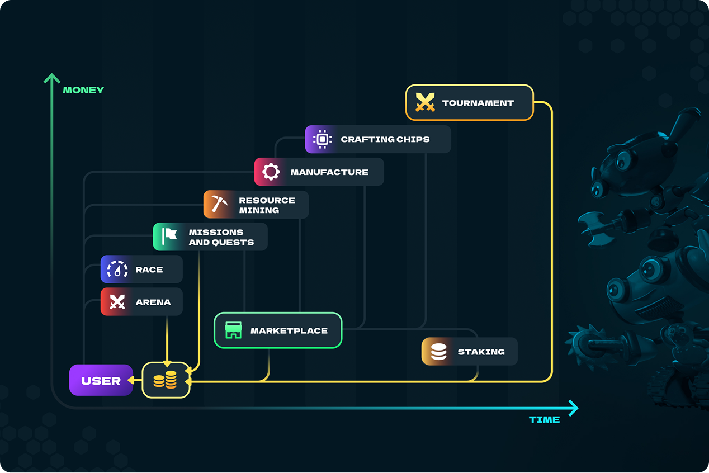

**BattleVerse** — это Web3-игра в жанре PvP/PvE с уникальными NFT-персонажами, прокачкой, добычей ресурсов, крафтом, выполнения миссий и заданий, с внутриигровой экономикой на токенах QZQ и BVC, в межгалактическом масштабе.

## Моя роль

Game Designer / Systems Designer. В зоне моей ответственности были: боевой кор-луп, баланс атрибутов и eXP, система крафта и расходников, а также проектирование долгосрочных мета-систем и пользовательского пути (онбординг).

## Задача

Создать простую кор-механику PvP/PvE и боевую систему с прокачкой персонажей, на которой игроки могут зарабатывать на аренах и турнирах. Изначально задача была расширить NFT-части персонажей, чтобы через них создавалась уникальность и она записывалась в NFT. Дальше идея расширилась до экономики с добычей и торговлей ресурсами, миссиями и квестами, и режимом гонок. Отдельная задача - онбординг: игрок без знания крипты должен быстро разобраться в механиках и захотеть купить других NFT-персонажей

::space 32
## Что я сделал
::space 24
**Боевая система** 

- пошаговый кор с фазами на основе механики Камень-Ножницы-Бумага.
- Основные удары, скиллы и расходники были несколько раз переработаны в удобное быстрое управление. 
- Просчитал баланс БС, скиллов и расходников  
- систему матчмейкинга на основе рейтингов ЭЛО.

*1. Схема боевой системы. 2. Экран PvP битвы. Первая этирация БС имела только основные удары, позже расширили до скилов и раходников. На экране битвы снизу в центре  распологается основное управления персонажем. Сверху вниз кнопки выбора дейсвтий по фазам хода: **расходник → скилы → основной удар → ход***

::space 32
**Редкость и прокачка** 

- система Rarity - редкость атрибутов персонажей. 
- В команде с GD разработали систему Character Upgrade. 
- Отвечал за рассчёт баланса получения и роста eXP, зависимостей прокачки и тайминги.

*1. Схема системы редкости и зависимостей атрибутов персонажа. 2. Экран улучшения атрибутов персонажа. Была выбрана стандартная модель Доната, чтобы помочь игроку сократить ожидание.*
::space 32

**Инвентарь, крафт и расходники** 

- дроп ресурсов после боя, которые используются в крафт или продаже на Маркетплейс; 
- баланс дропа и крафта и рецептов расходников. 

*Схема боевой системы и экран PvP битвы. Первая этирация БС имела только основные удары, позже расширили до скилов и раходников. На экране битвы в центре снизу распологается основное управления. Сверху вниз кнопки выбора дейсвтий по фазам хода: *расходник → скилы → основной удар → ход*
::space 32

**Мета-гейм** 

- Badges с условиями получения и описаниями; 
- Staking персонажей с прибылью игровой валюты и энергии (пул в личном кабинете, разлив энергии по другим персанажам, продажа на Маркете); 
- лиги и рейтинги игроков со статусами и рамками портрета (не реализованы)

*Схема боевой системы и экран PvP битвы. Первая этирация БС имела только основные удары, позже расширили до скилов и раходников. На экране битвы в центре снизу распологается основное управления. Сверху вниз кнопки выбора дейсвтий по фазам хода: *расходник → скилы → основной удар → ход*
::space 32

**Режимы:** 

- Гонки с кор-механикой, балансом, геймплеем и прокачкой болидов, ставками на соревнованиях и призом из общего фонда от числа участников; 
- PvE-миссии с фармом лута, растущей сложностью мобов и шансом дропа.

*Схема боевой системы и экран PvP битвы. Первая этирация БС имела только основные удары, позже расширили до скилов и раходников. На экране битвы в центре снизу распологается основное управления. Сверху вниз кнопки выбора дейсвтий по фазам хода: *расходник → скилы → основной удар → ход*
::space 32

**Производство (Industry)** 
- расширение крафта до производственных цепочек ресурсов с продажей на Маркетплейсе и созданием более крутых и уникальных расходников и ресурсов.

*Схема боевой системы и экран PvP битвы. Первая этирация БС имела только основные удары, позже расширили до скилов и раходников. На экране битвы в центре снизу распологается основное управления. Сверху вниз кнопки выбора дейсвтий по фазам хода: *расходник → скилы → основной удар → ход*

- **Онбординг:** выстроил путь игрока от покупки первого NFT до участия в PvP-сражениях, упростив сложные крипто-сущности до понятных игровых механик.

## Результат

- Запущен и протестирован концепт: проект прошел путь от идеи до играбельного прототипа, успешно выступил на BinanceGameFi-хакатоне и занял призовое 3 место.

- Выстроена устойчивая Web3-экономика: создана система NFT-персонажей, прокачки и торговли ресурсами, которая стимулирует игроков к долгосрочному взаимодействию.

- Сформировано лояльное комьюнити: проект привлек более 10K+ подписчиков в сообществе, а стадия тестирования собрала около 1000 реальных игроков.

- Упрощен порог входа: успешно убран сложный крипто-жаргон из интерфейса, что позволило привлечь аудиторию, не знакомую с блокчейном.

- Масштабирование: концепт перерос в полноценный проект с трехлетним планом разработки и привлечённым финансированием.

*Схема полного цикла Monetisation: желтыми линиями показан прямой источник прибыли для Игроков*
