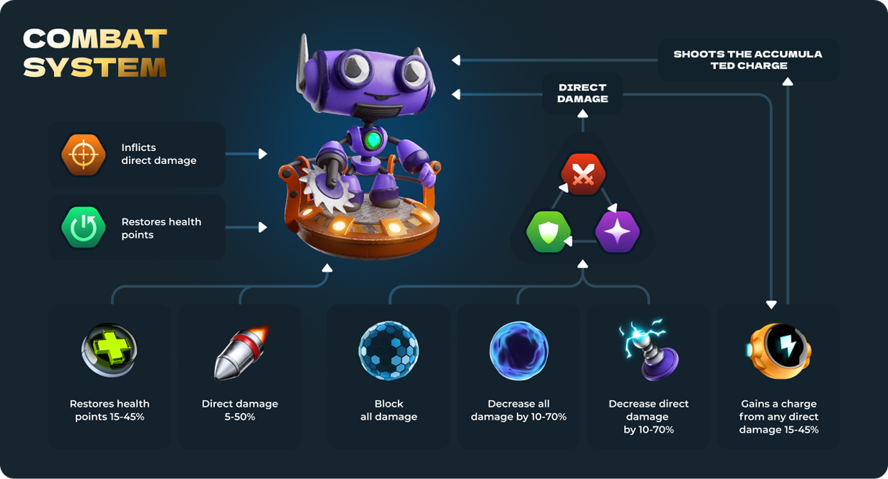
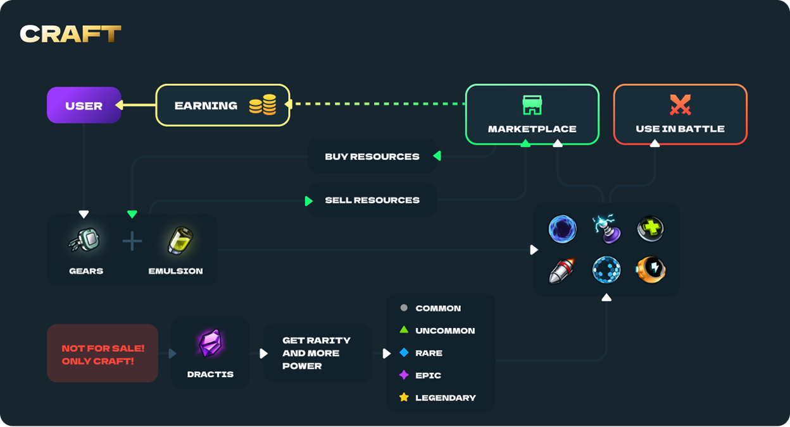
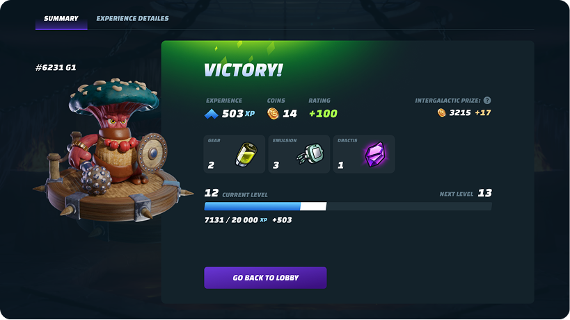
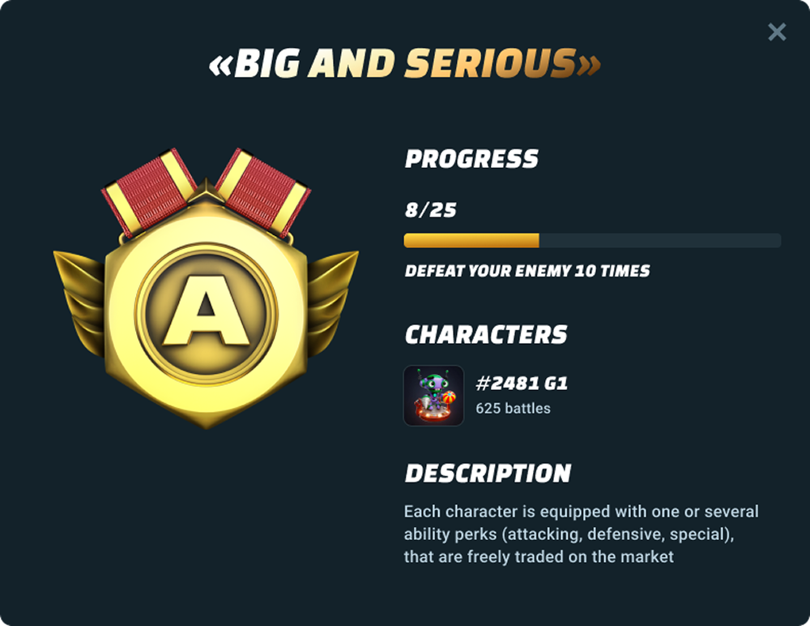
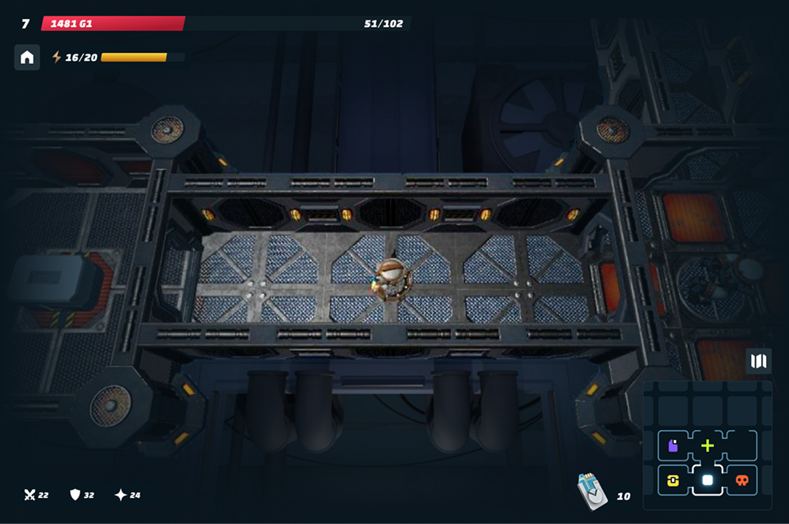
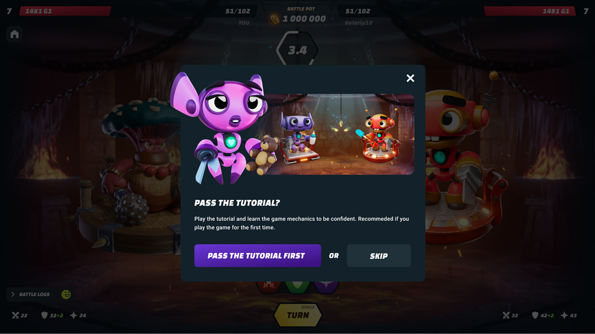
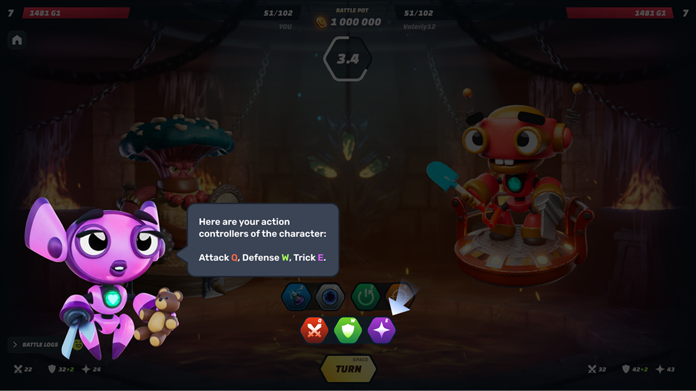

**BattleVerse** — это масштабная Web3-вселенная в жанре PvP/PvE. Игрокам нужно сражаеться за территории в межгалактических турнирах, строить свою империю: фармить ресурсы, крафтить предметы и выводить уникальных NFT-персонажей с помощью механики скрещивания (Breeding). Вся экономика игры держится на токенах QZQ и BVC, а судьба проекта в руках DAO.

- **Межгалактические турниры:** Сражения за звание сильнейшего, участие в масштабных ивентах и частных лобби, чтобы получить доступ к элитному бридингу.
- **Скрещивание (Breeding):** Скрещивание персонажей разных рас, чтобы вывести абсолютно новых, кастомных героев.
- **Фарминг и Экономика:** Покупка территорий и строительство фабрик для производства уникальных ресурсов и чипов, билетов на турниры и добычи токенов $QZQ.
- **Уникальные расы:** миролюбивые грибы Шрумы и боевых Бэби роботы, стремящиеся очеловечить себя.

## Моя роль

Game Designer / Systems Designer. В зоне моей ответственности были: боевой кор-луп, баланс атрибутов и eXP, система крафта и расходников, а также проектирование долгосрочных мета-систем и пользовательского пути (онбординг).

## Задача

Создать простую кор-механику PvP/PvE и боевую систему с прокачкой персонажей, на которой игроки могут зарабатывать на аренах и турнирах. Изначально задача была расширить NFT-части персонажей, чтобы через них создавалась уникальность и она записывалась в NFT. Дальше идея расширилась до экономики с добычей и торговлей ресурсами, миссиями и квестами, и режимом гонок. Отдельная задача - онбординг: игрок без знания крипты должен быстро разобраться в механиках и захотеть купить других NFT-персонажей

## Что я сделал
::space 24
**Боевая система** 

- пошаговый кор с фазами на основе механики Камень-Ножницы-Бумага.
- Основные удары, скиллы и расходники.  
- Просчитал баланс БС, скиллов и расходников  
- систему матчмейкинга на основе рейтингов ЭЛО.

*1. Схема боевой системы. 2. Экран PvP битвы. Первая этирация БС имела только основные удары, позже расширили до скилов и раходников. На экране битвы снизу в центре  распологается основное управления персонажем. Сверху вниз кнопки выбора дейсвтий по фазам хода: **расходник → скилы → основной удар → ход***
*Скиллы и расходники были несколько раз переработаны.*
::space 32

**Редкость и прокачка** 

- система Rarity - редкость атрибутов персонажей. 
- В команде с GD разработали систему Character Upgrade. 
- Отвечал за рассчёт баланса получения и роста eXP, зависимостей прокачки и тайминги.

*Схема системы крафта слева и экран крафта с рецептами справа.*
::space 32

**Инвентарь, крафт и расходники** 

- дроп ресурсов после боя, которые используются в крафт или продаже на Маркетплейс; 
- баланс дропа и крафта и рецептов расходников. 

*1. Схема системы крафта. 2. Экран дропа ресурсов и награды после боя(при проигрыше или ничьей - игроки тоже получают награду в меньшей степени). 3. Экран крафта с рецептами.*
::space 32

**Мета-гейм** 

- Badges с условиями получения и описаниями; 
- Staking персонажей с прибылью игровой валюты и энергии (пул в личном кабинете, разлив энергии по другим персанажам, продажа на Маркете); 
- лиги и рейтинги игроков со статусами и рамками портрета (не реализованы)

*Скрин экрана стейкинга и модальное окно с бэйджем за заслуги*
::space 32

**Дополнительные игровые режимы** 

- гонки с кор-механикой, балансом, геймплеем и прокачкой болидов, ставками на соревнованиях и призом из общего фонда от числа участников; 
- PvE-миссии с фармом лута, растущей сложностью мобов и шансом дропа. 

*Слева - экран PvE режима “Journey”. Справа - протитип режима “Racing”, который в последствии развился до полноценной самостоятельной игры со ставками. Оба режима находятся на этапе тестирования и пока что являются играбельными прототипами*
::space 32

**Разработал долгосрочный мета-гейм Lands & Territories:** 

- полный цикл от покупки/аренды земли и добычи сырья до крафта компонентов и продажи на Маркетплейсе.
- Описал в GDD логику зданий (Drilling rig, Factory, Warehouse), правила крафта и зависимости ресурсов (Energy, Ore, Chips).

**Ключевая задача:** просчитать драфтовый баланс так, чтобы новичок без капитала мог встроиться в экономику (добыча сырья), а «киты» могли строить производственные империи.
*Это был блок долгосрочной мета-прогрессии. Мы зафиксировали его в GDD и просчитали драфтовый баланс, чтобы понять, как он будет влиять на экономику на поздних этапах. Реализация не вошла в текущий скоуп прототипа, так как фокус был на боевой системе и хакатонной демо-версии, но документация готова к передаче в разработку*

*Схема боевой системы и экран PvP битвы. Первая этирация БС имела только основные удары, позже расширили до скилов и раходников. На экране битвы в центре снизу распологается основное управления. Сверху вниз кнопки выбора дейсвтий по фазам хода: *расходник → скилы → основной удар → ход*
::space 32

**Онбординг** 

- выстроил путь игрока от покупки первого NFT до участия в PvP-сражениях, упростив сложные крипто-сущности до понятных игровых механик.

*На первом скрине старт тутора в режиме Арены, который можно скипнуть. На втором скрине объяснение логики выбора действий*

## Результат

- Запущен и протестирован концепт: проект прошел путь от идеи до играбельного прототипа, успешно выступил на BinanceGameFi-хакатоне и занял призовое 3 место.

- Выстроена устойчивая Web3-экономика: создана система NFT-персонажей, прокачки и торговли ресурсами, которая стимулирует игроков к долгосрочному взаимодействию.

- Сформировано лояльное комьюнити: проект привлек более 10K+ подписчиков в сообществе, а стадия тестирования собрала около 1000 реальных игроков.

- Упрощен порог входа: успешно убран сложный крипто-жаргон из интерфейса, что позволило привлечь аудиторию, не знакомую с блокчейном.

- Масштабирование: концепт перерос в полноценный проект с трехлетним планом разработки и привлечённым финансированием.

*Схема полного цикла Monetisation: желтыми линиями показан прямой источник прибыли для Игроков*
