## i
**BattleVerse** is a large-scale Web3 universe in the PvP/PvE genre. Players must fight for territories in intergalactic tournaments, build their empire: farm resources, craft items, and breed unique NFT characters using the Breeding mechanic. The entire game economy relies on the QZQ and BVC tokens, and the fate of the project is in the hands of the DAO.
::space 8
- **Intergalactic Tournaments:** Battles for the title of the strongest, participation in large-scale events and private lobbies to gain access to elite breeding.
- **Breeding:** Crossing characters of different races to produce completely new, custom heroes.
- **Farming and Economy:** Buying territories and building factories to produce unique resources and chips, tournament tickets, and mining $QZQ tokens.
- **Unique Races:** peace-loving Shrooms and combat Baby Robots striving to humanize themselves.

## My Role

Game Designer / Systems Designer. My responsibilities included: combat core loop, attribute and eXP balance, crafting and consumables system, as well as designing long-term meta-systems and the user journey (onboarding).

## Task

Create a simple PvP/PvE core mechanic and a combat system with character progression, where players can earn on arenas and tournaments. Initially, the task was to expand the NFT parts of characters so that uniqueness could be created through them and recorded in the NFT. Later, the idea expanded to an economy with resource extraction and trading, missions and quests, and a racing mode. A separate task was onboarding: a player without crypto knowledge should quickly understand the mechanics and want to buy other NFT characters.

## What I Did
::space 24
**Combat System** 

- turn-based core with phases based on the Rock-Paper-Scissors mechanic.
- Basic attacks, skills, and consumables.  
- Calculated the balance of combat stats, skills, and consumables  
- matchmaking system based on ELO ratings.

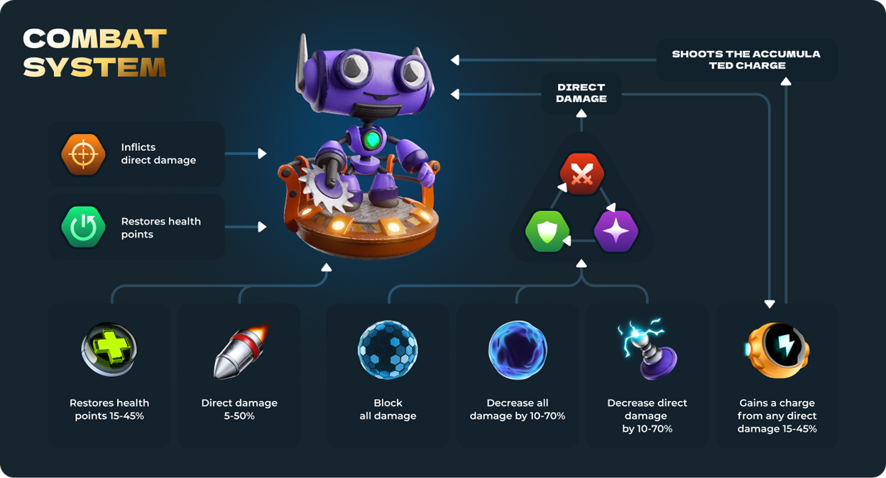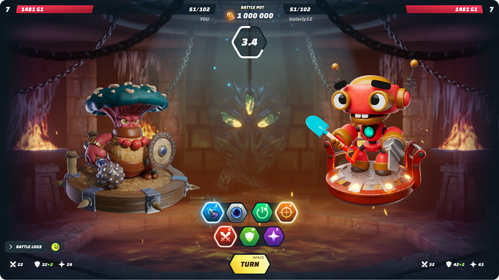
*1. Combat system diagram. 2. PvP battle screen. The first iteration of the combat system had only basic attacks, later expanded to skills and consumables. On the battle screen, the main character control is located at the bottom center. From top to bottom, the action selection buttons by turn phases: **consumable → skills → basic attack → turn***
*Skills and consumables were reworked several times.*
::space 32

**Rarity and Progression** 

- Rarity system - attribute rarity of characters. 
- Together with the GD, developed the Character Upgrade system. 
- Responsible for calculating the balance of eXP acquisition and growth, progression dependencies, and timings.

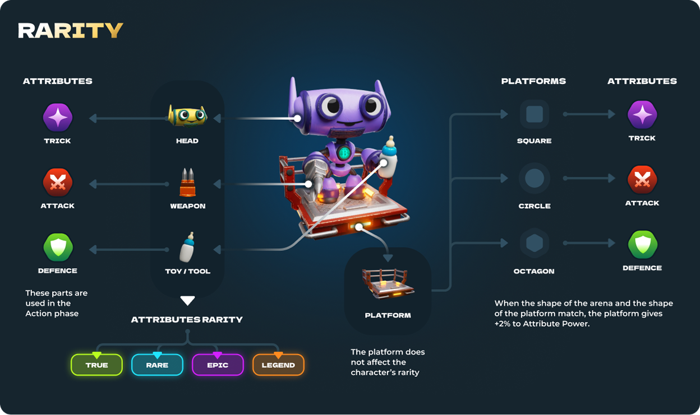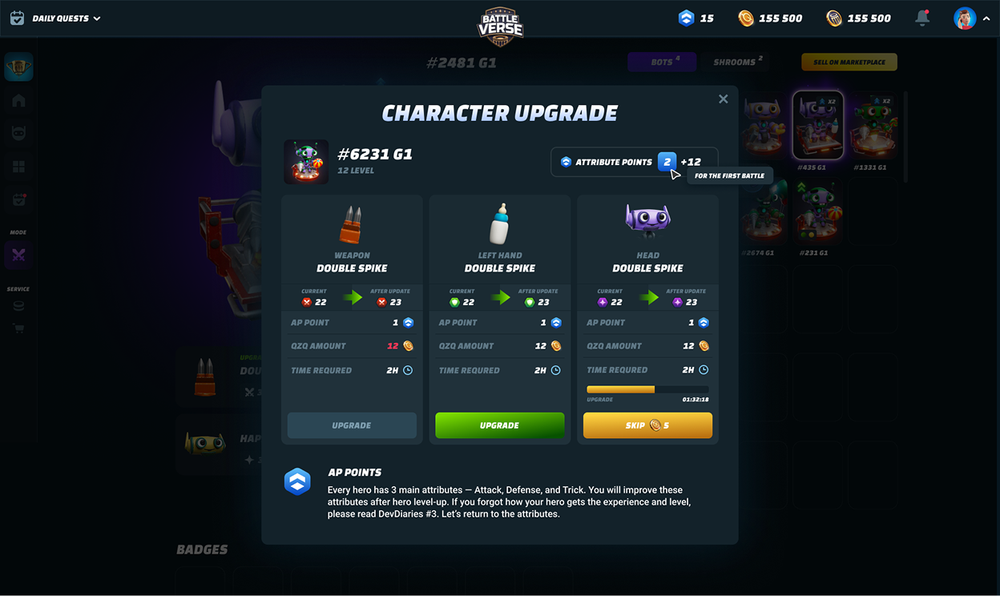
*Crafting system diagram on the left and the crafting screen with recipes on the right.*
::space 32

**Inventory, Crafting, and Consumables** 

- resource drops after battle, which are used in crafting or sold on the Marketplace; 
- balance of drops, crafting, and consumable recipes. 

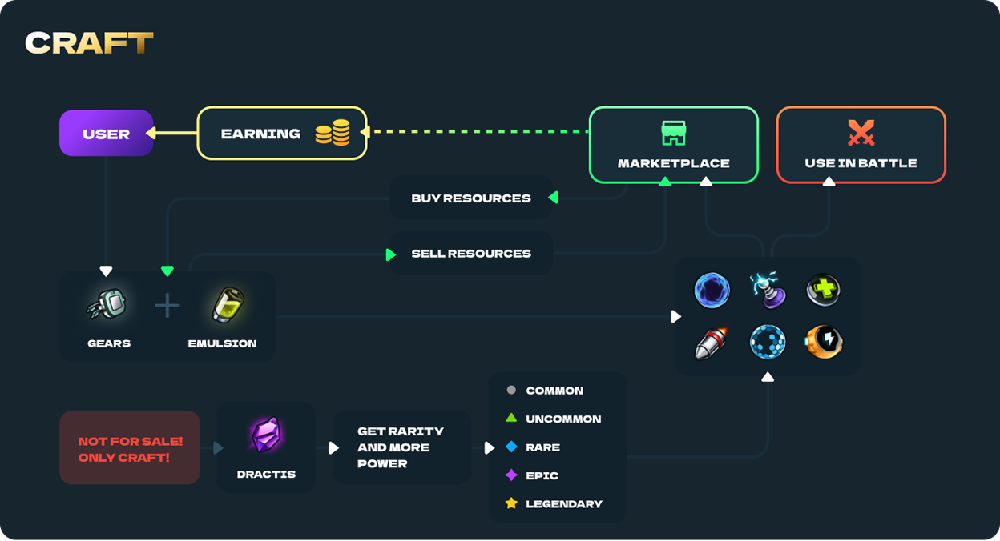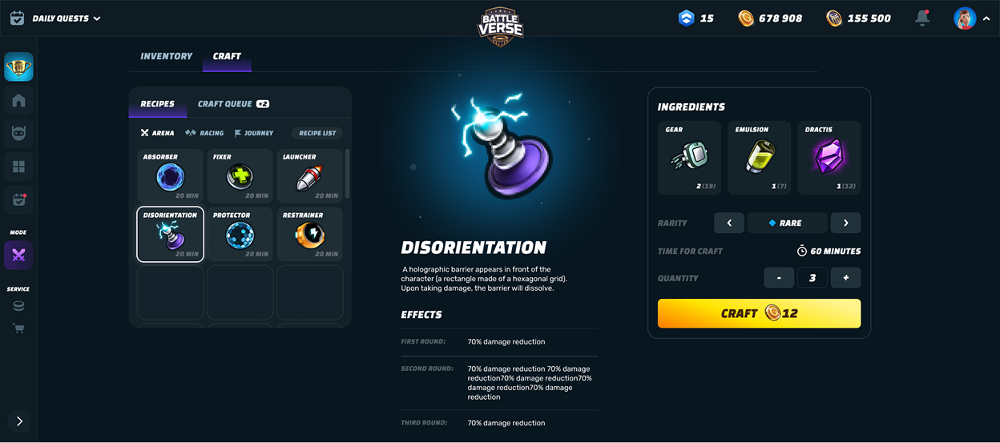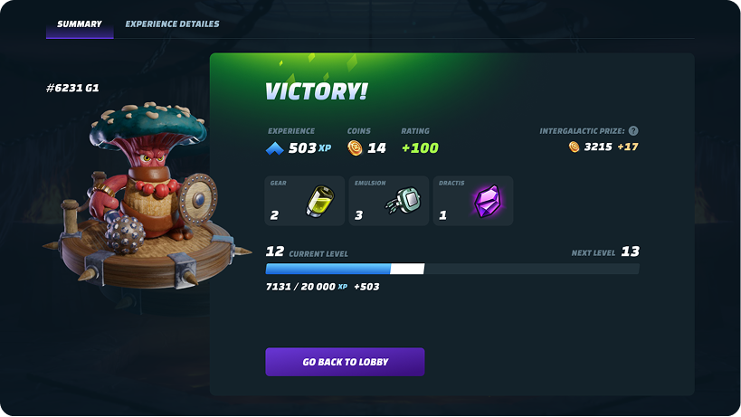
*1. Crafting system diagram. 2. Resource drop and post-battle reward screen (on defeat or draw - players also receive a reward to a lesser extent). 3. Crafting screen with recipes.*
::space 32

**Meta-game** 

- Badges with acquisition conditions and descriptions; 
- Character Staking with game currency and energy profit (pool in personal account, energy distribution to other characters, sale on the Market); 
- leagues and player ratings with statuses and portrait frames (not implemented)
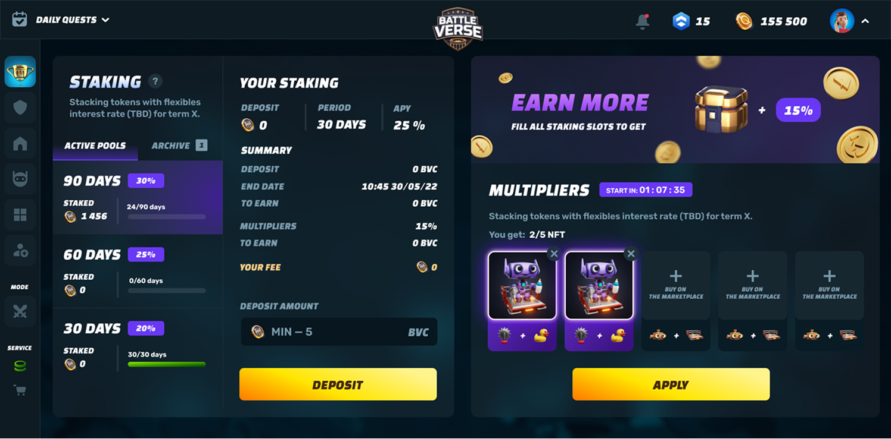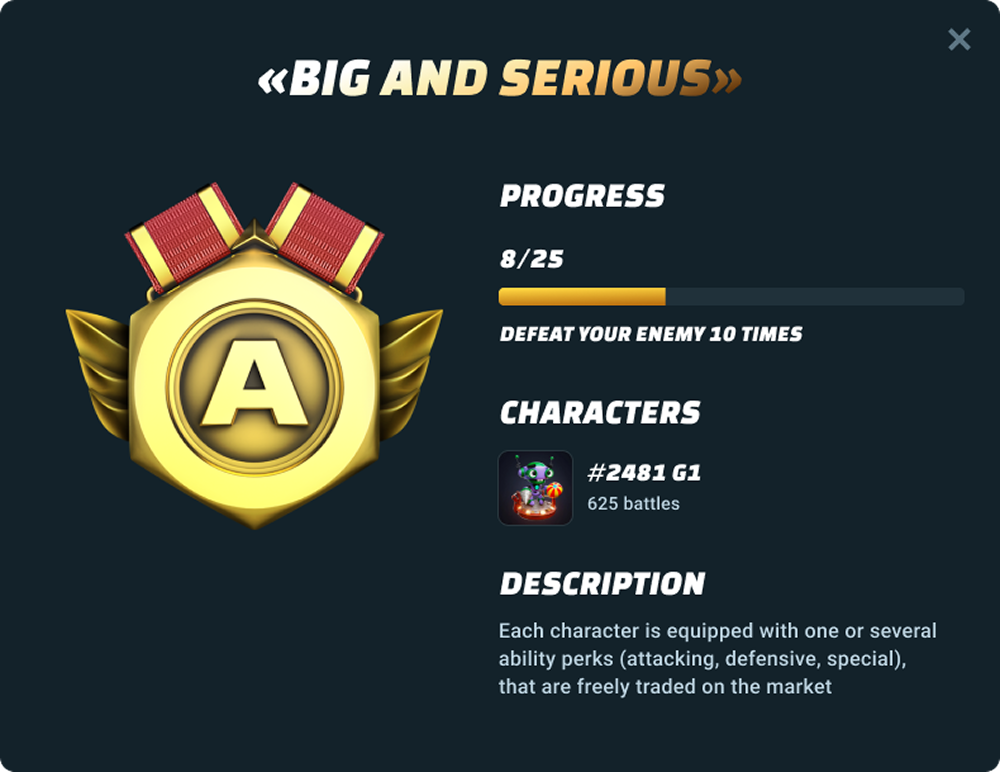
*Staking screen screenshot and modal window with an achievement badge*
::space 32

**Additional Game Modes** 

- racing with core mechanics, balance, gameplay, and vehicle upgrades, bets on competitions, and a prize from a shared fund based on the number of participants; 
- PvE missions with loot farming, increasing mob difficulty, and drop chance. 
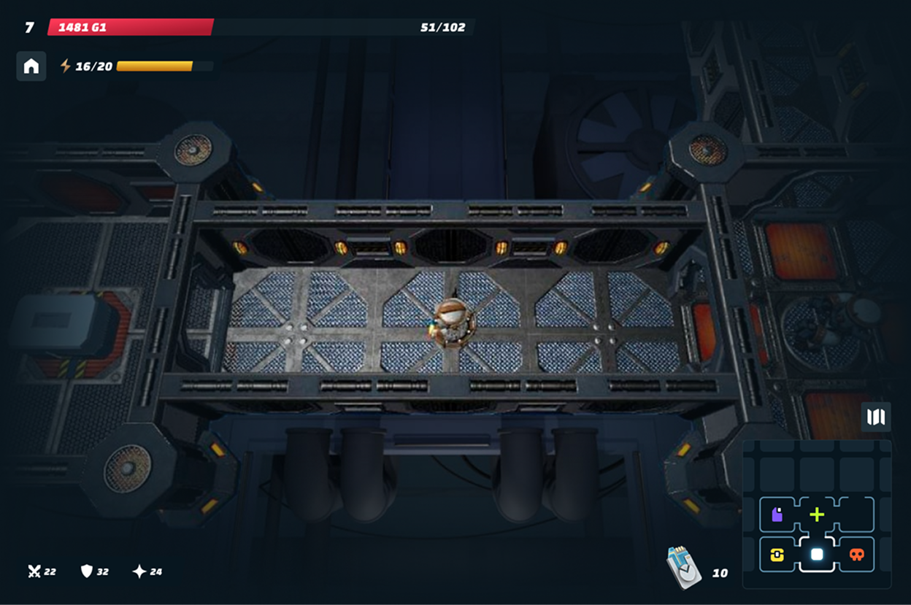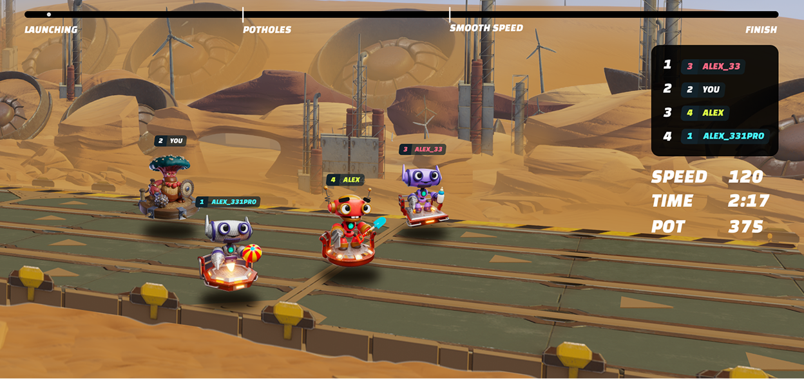
*On the left - PvE mode screen "Journey". On the right - prototype of "Racing" mode, which later evolved into a full-fledged standalone game with bets. Both modes are in testing and are currently playable prototypes*
::space 32

**Developed long-term meta-game Lands & Territories:** 

- full cycle from buying/renting land and extracting raw materials to crafting components and selling on the Marketplace.
- Described building logic (Drilling rig, Factory, Warehouse), crafting rules, and resource dependencies (Energy, Ore, Chips) in the GDD.

**Key task:** calculate the draft balance so that a beginner without capital could integrate into the economy (raw material extraction), and "whales" could build production empires.

*This was a block of long-term meta-progression. We fixed it in the GDD and calculated the draft balance to understand how it would affect the economy in the later stages. Implementation was not included in the current prototype scope, as the focus was on the combat system and the hackathon demo version, but the documentation is ready for handover to development*
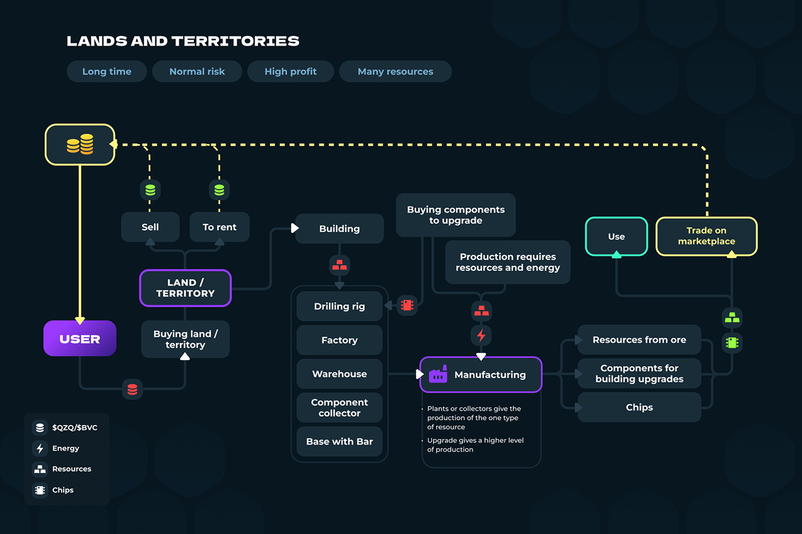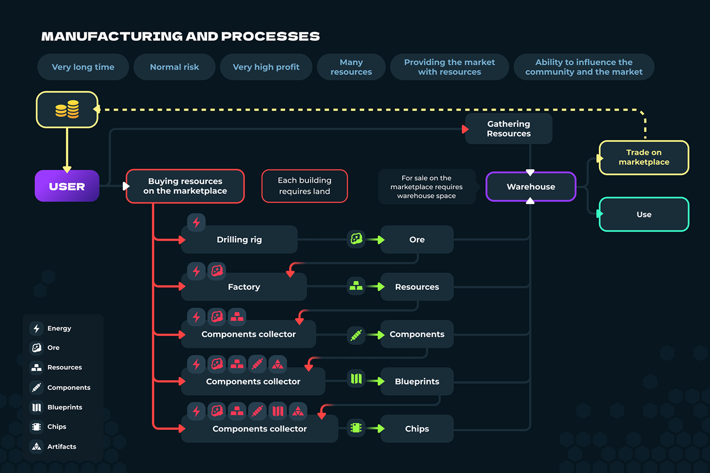
*Production cycle diagram (Industry Loop). On the left - general land ownership logic, on the right - detailed map of crafting and resource processing, designed for the GDD*
::space 32

**Onboarding** 

- built the player journey from purchasing the first NFT to participating in PvP battles, simplifying complex crypto entities into understandable game mechanics.
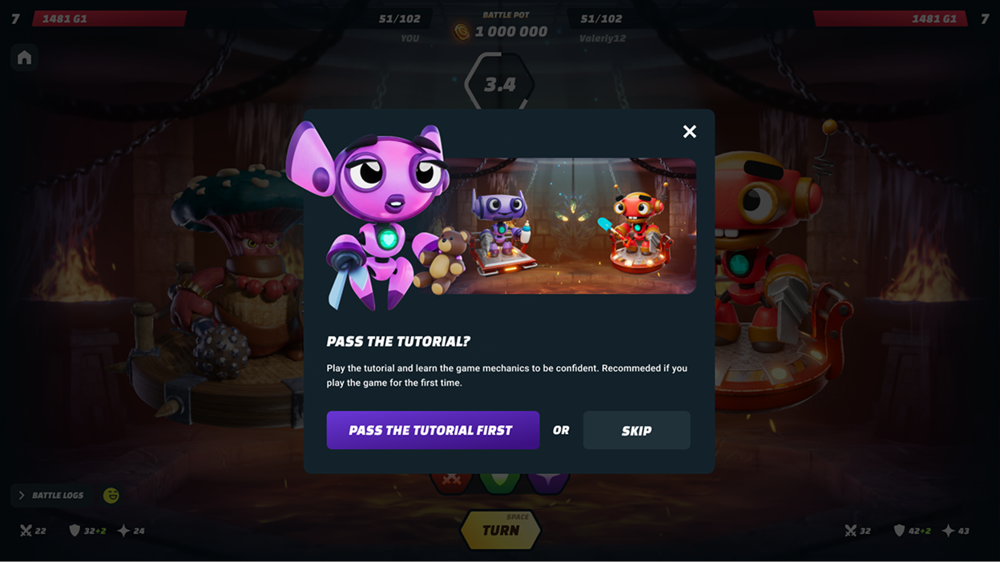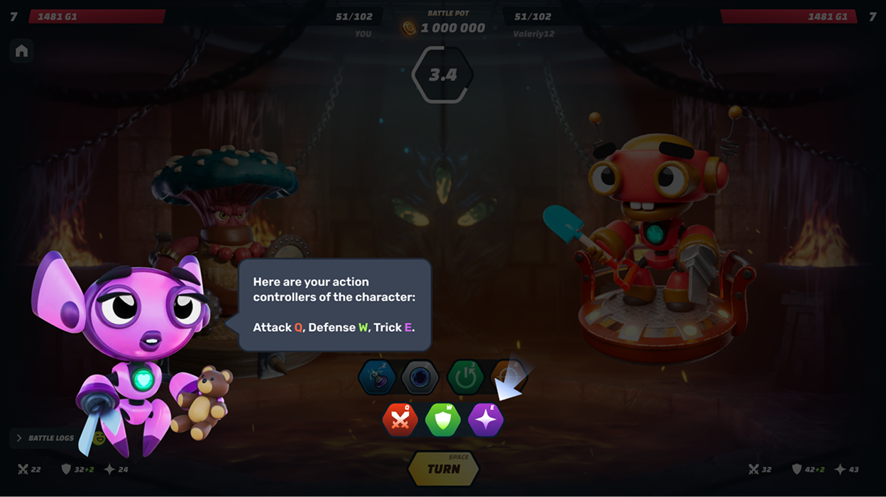
*The first screenshot shows the start of the tutorial in Arena mode, which can be skipped. The second screenshot explains the logic of action selection*

## Result

- Launched and tested concept: the project went from idea to playable prototype, successfully performed at the BinanceGameFi hackathon and took 3rd place.

- Built a sustainable Web3 economy: created a system of NFT characters, progression, and resource trading that encourages players to engage long-term.

- Formed a loyal community: the project attracted over 10K+ followers in the community, and the testing stage gathered about 1000 real players.

- Simplified the entry threshold: complex crypto jargon was successfully removed from the interface, which allowed attracting an audience unfamiliar with blockchain.

- Scaling: the concept grew into a full-fledged project with a three-year development plan and raised funding.

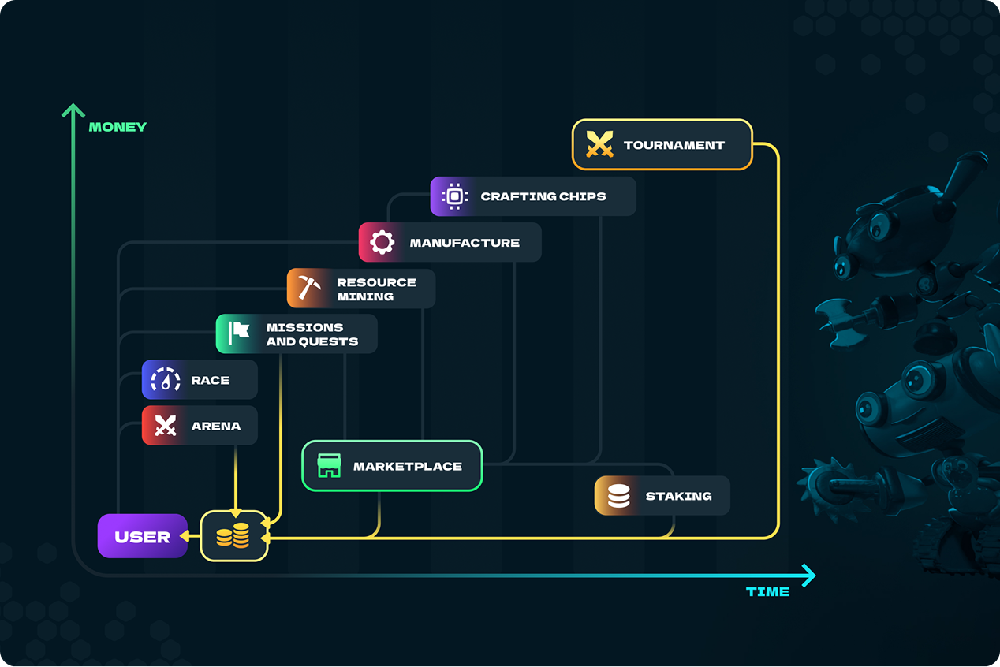
*Full monetization cycle diagram: yellow lines show the direct source of profit for Players*